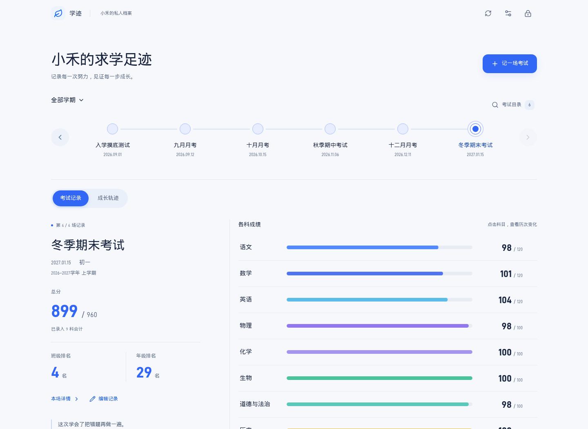

# 学迹

一份陪伴孩子成长的私人求学纪念册。记录考试、回看学科变化，也把每一次认真留给未来。

**独立 Docker 部署，无需 Home Assistant。** 以下截图及仓库内测试数据均为虚构示例，不含真实孩子资料。



<details><summary>查看手机预览</summary>


</details>

## 功能

- 按时间查看考试，支持月考、期中、期末和自定义考试名称。
- 记录各科得分、满分、总分、班级和年级排名，按学期筛选。
- 查看成绩趋势、对比考试，保存成绩查询截图。
- 密码保护、手机及桌面适配、ZIP 备份与恢复、CSV 导出。

## 安装

需要 Docker 和 Docker Compose。默认仅监听部署机器的本地地址，供首次安全设置密码。

```bash
git clone https://github.com/apt-ins/child-gradebook.git
cd child-gradebook
cp .env.example .env
mkdir -p data
# 容器以 UID 1000 运行，确保 data 对该用户可写。
sudo chown 1000:1000 data
docker compose up -d --build
docker compose ps
```

在部署机器的浏览器打开 `http://127.0.0.1:3082`，设置至少 10 个字符的密码。若部署机器没有浏览器，可在自己的电脑上使用 SSH 本地端口转发（将 `your-server` 换成自己的服务器）：

```bash
ssh -L 3082:127.0.0.1:3082 your-server
```

保持 SSH 连接，然后在自己电脑的浏览器打开 `http://127.0.0.1:3082` 完成设置。**请先设置密码，再开放局域网或外网访问。**

需要让其他设备访问时，可修改 `.env` 中的 `BIND_ADDRESS` 为 `0.0.0.0`，再执行 `docker compose up -d`。访问地址为部署机器的实际 IP 和 `3082` 端口。外网访问建议配置 HTTPS 反向代理，并在 `.env` 的 `TRUSTED_PROXY_CIDRS` 中填写可信代理的精确 CIDR，使应用识别 HTTPS 请求并设置安全 Cookie；不要信任所有代理。端口可通过 `APP_PORT` 修改。

## 数据、迁移与密码

- 数据保存在 `data/`，请定期使用页面「档案工具」导出完整 ZIP 备份，或备份整个数据目录。截图也包含在完整备份中。
- 可以在原 HA 版中导出完整 ZIP，再在独立版「档案工具」中预览并恢复。恢复会替换现有成绩，但不会更改独立版的密码；恢复前系统会保存一份备份。
- 登录后可在「档案工具」中修改密码；修改后其他设备需重新登录。
- 忘记密码时，先把 `.env` 中 `BIND_ADDRESS` 设回 `127.0.0.1`，然后执行以下命令。重置不会删除考试或截图；重新启动后仅通过本机或 SSH 转发设置新密码。

```bash
docker compose stop
docker compose run --rm --no-deps gradebook node server/reset-password.js
docker compose up -d
```

请不要将 `.env`、`data/`、真实备份或个人截图提交到公开仓库。

## 开发与测试

需要 Node.js 22、npm 和 Chromium：

```bash
npm ci
npm run build
npm test
npx playwright install chromium
npx playwright test
```

浏览器测试使用临时数据库和虚构成绩，不连接真实数据。

## 技术与许可

前端使用 Vue 3、TypeScript、Vite；服务端使用 Express 和 SQLite。项目采用 [MIT 许可证](LICENSE)。随项目提供的 D-DIN 字体有独立许可，详见 `public/fonts/` 中的许可文件。
